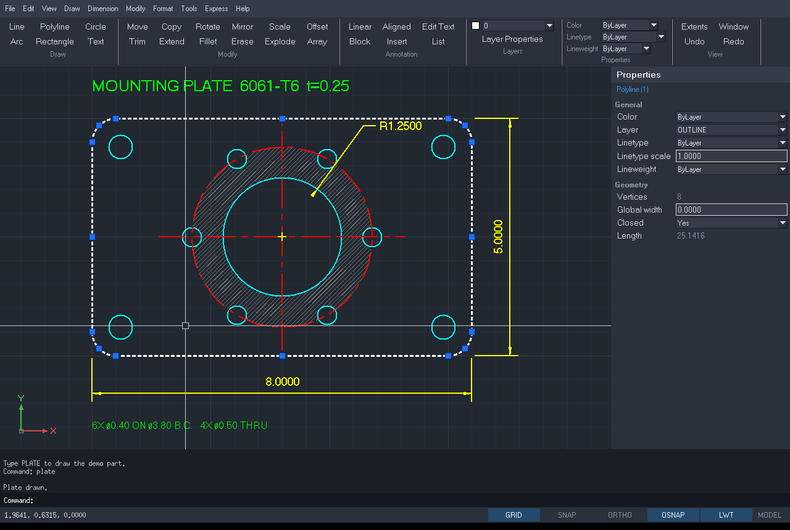

# Fancy Pencil




A 2D drafting program written in Common Lisp that works like AutoCAD and runs AutoLISP.
Same command names and aliases, the same prompts, a command line with the same input rules,
object snaps, noun/verb selection, layers, blocks, dimensions, and DXF in and out. Your existing
AutoLISP routines (`defun c:...`, `command`, `entget`/`entmod`, `ssget` filters, `initget`/`getkword`,
`*error*` handlers) run unchanged in most cases.

## Install and run (Ubuntu / Debian)

```sh
sudo apt install sbcl tk
cd fancypencil
./fancypencil                      # GUI
./fancypencil drawing.dxf          # open a drawing
./fancypencil examples/tools.lsp   # load AutoLISP at startup
./fancypencil --tty                # terminal-only mode (command line + AutoLISP, no window)
```

The first start compiles the sources (a few seconds); later starts use the cached build in `build/`.
Nothing else is needed: no Quicklisp, no libraries. The GUI is Tk, driven over a pipe from Lisp.
If `wish` isn't on your PATH, set `FANCYPENCIL_WISH=/path/to/wish`.
When started from the app launcher, error messages go to `~/.cache/fancypencil.log`.

Open/Save dialogs use your desktop's own file chooser (`zenity` on GNOME/Ubuntu, `kdialog` on KDE),
so every mounted drive, bookmark and Recent is in the sidebar. Without either, Tk's simpler dialog is
used (`sudo apt install zenity` to get the full one). Set `FANCYPENCIL_FILEDIALOG=tk` to force Tk's.

### Add it to the application launcher

```sh
sh install.sh              # adds "Fancy Pencil" with its icon to your app menu / dash
sh install.sh --uninstall  # removes it again
```

This installs the icon (`support/icons`, SVG plus 16–512 px PNGs) into
`~/.local/share/icons/hicolor` and a `fancypencil.desktop` entry into `~/.local/share/applications`,
pointing at wherever this folder is. If you move the folder, run `install.sh` again. Once it shows
in the launcher you can right-click it and choose *Add to Favorites* to pin it to the dock. DXF files
can be opened with it from the file manager (*Open With → Fancy Pencil*).

Fancy Pencil was called LispDraft before 0.3. Aliases you saved with ALIASEDIT under the old name
(`~/.config/lispdraft/lispdraft.pgp`) and a `~/.lispdraft.lsp` startup file are still picked up.

### Right-click, object snaps, ALIGN, dimension styles

- **Right-click on the drawing** at the Command: prompt opens a menu: Repeat last command, Recent Input,
  and with objects selected Erase, Move, Copy, Scale, Rotate, Mirror, Align, Array, Cut/Copy to the
  clipboard, Deselect All and Properties (Undo/Redo, Zoom, Paste, Select All when nothing is selected).
  While a command is running, right-click is Enter, as in AutoCAD.
- **Object snaps:** OSNAP (OS, DS, Tools → Object Snap Settings, or right-click the OSNAP button) opens
  a panel with Endpoint, Midpoint, Center, Node, Quadrant, Intersection, Insertion, Perpendicular,
  Tangent and Nearest. **Shift + right-click** while picking a point gives a one-time snap menu.
  -OSNAP sets them at the command line.
- **ALIGN (AL):** pick source/destination point pairs; one pair moves, two pairs move and rotate, and
  optionally scale to fit.
- **Dimension Style Manager (D, DIMSTYLE):** styles list with Set Current / New (start from any style) /
  Delete, tabs for Lines, Symbols and Arrows, Text, Fit and Primary Units, and a live preview. Arrowheads:
  closed filled, closed blank, open, right angle, dot, small dot, **architectural tick**, oblique, none.
  Changing a style updates the dimensions that use it. EXPLODE breaks a dimension into its parts.
  Arrowheads are saved the way AutoCAD stores them (`_ArchTick`, `_Oblique` ... blocks referenced by
  the dimension style), in both DXF formats and so in DWG, and are read back from AutoCAD drawings.

### What survives opening an AutoCAD drawing

Dimensions keep the appearance AutoCAD saved with them (and are only redrawn by Fancy Pencil when you
edit one); leaders (callout arrows) are kept and editable; draw order ("Send to Back") is honoured; hatches
keep their island style and full-circle boundaries. Not yet supported: raster images, PDF/DWF/DGN
underlays, regions, 3D solids, tables, multileaders and paper-space layouts. When a drawing contains
any of these, opening it says so, and saving over that file asks first.

### Several drawings at once

Every drawing opens in its own tab above the drawing area, as in AutoCAD. OPEN and NEW add a tab
(OPEN reuses an untouched empty Drawing1, and switches to a file that is already open); click a tab
to switch, its × (or a middle-click) to close it, + for a new drawing. Ctrl+Tab / Ctrl+Shift+Tab cycle
through them, Ctrl+F4 or CLOSE closes the current one, CLOSEALL closes all, and the Window menu lists
them. Each drawing keeps its own view, selection, undo history, layers and settings; program-wide
settings (object snaps, Ortho, grid, pickbox ...) follow you between tabs. COPYCLIP / PASTECLIP work
between drawings. QUIT offers to save every changed drawing. `./fancypencil a.dxf b.dwg` opens both.

### Opening and saving DWG files

DWG is AutoCAD's closed binary format, so Fancy Pencil converts it with a free converter:

- **ODA File Converter** (recommended): reads and writes every AutoCAD version. Download the Ubuntu
  `.deb` from opendesign.com ("ODA File Converter"), then `sudo apt install ./ODAFileConverter_*.deb`.
- **LibreDWG** `dwg2dxf` (open source): opening only. Not packaged for Ubuntu 24.04; build it from
  github.com/LibreDWG/libredwg.

Fancy Pencil finds whichever is installed (or set `FANCYPENCIL_DWG_CONVERTER=/path/to/program`).
OPEN shows DWG and DXF files; a DWG opens like any drawing, and SAVE writes it back as DWG (AutoCAD
2018 format) with the previous file kept as `name.bak`. Without ODA File Converter, saving asks for a
DXF name instead and never touches the DWG.

Any `acaddoc.lsp` or `fancypencil.lsp` in the current directory, and `~/.fancypencil.lsp`, are loaded
at startup, and `S::STARTUP` is called if defined, just like AutoCAD.

## Using it

It behaves like AutoCAD's command line:

- Type a command or alias (`L`, `C`, `PL`, `TR` ...) and press Enter or Space. Enter on an empty
  prompt repeats the last command. Esc cancels. Right-click acts as Enter.
- Coordinates: `3,4`  `@2,0` (relative)  `@5<45` (polar)  or a bare number for direct distance
  along the rubber band. Distances accept feet-inches (`2'6`) and fractions (`1 1/2`).
- Type `END`, `MID`, `CEN`, `INT`, `PER`, `TAN`, `QUA`, `NOD`, `INS`, `NEA` or `NON` at a point
  prompt for a one-time snap override.
- F3 OSNAP, F7 GRID, F8 ORTHO, F9 SNAP (or click the status bar toggles).
- Mouse wheel zooms at the cursor, middle-drag pans, middle double-click zooms extents.
- Click objects at the `Command:` prompt to select them first (noun/verb), drag left-to-right for a
  window, right-to-left for a crossing window, then run MOVE, ERASE (or press Delete), etc.
- Type AutoLISP straight at the prompt: `(+ 1 2)`, `!myvar`, or a multi-line expression (the
  prompt changes to `(_>` until the parentheses balance). Expressions also work inside prompts,
  e.g. `(polar (getvar "lastpoint") 0 5)` at "Specify next point".

### Commands

| Area | Commands (aliases) |
|---|---|
| Draw | LINE (L), PLINE (PL) with Arc/Width, RECTANG (REC), POLYGON (POL), CIRCLE (C) incl. 2P/3P, ARC (A) 3-point/Center/End, ELLIPSE (EL), POINT (PO), TEXT (DT), MTEXT (T), HATCH (H, BH), REVCLOUD (RC), BLOCK (B), INSERT (I) |
| Modify | ERASE (E), OOPS, MOVE (M), COPY (CO), ROTATE (RO), SCALE (SC), MIRROR (MI), OFFSET (O), TRIM (TR), EXTEND (EX), BREAK (BR), FILLET (F), CHAMFER (CHA), JOIN (J), STRETCH (S), ARRAY (AR), EXPLODE (X), PEDIT (PE), HATCHEDIT (HE), CHPROP, MATCHPROP (MA), COLOR, TEXTEDIT (ED), DIVIDE (DIV), COPYCLIP/PASTECLIP |
| Dimension | DIMLINEAR (DLI), DIMALIGNED (DAL), DIMRADIUS (DRA), DIMDIAMETER (DDI), DIMANGULAR (DAN), DIMCONTINUE (DCO), DIMBASELINE (DBA), DIMSTYLE (D) |
| View | ZOOM (Z) Extents/All/Window/Previous/Center, PAN (P), REGEN (RE) |
| Inquiry | DIST (DI), ID, AREA (AA), LIST (LI), PROPERTIES (PR, Ctrl+1) |
| Settings | LAYER (LA; dialog) and -LAYER, LAYMCUR, LINETYPE (LT), LTSCALE (LTS), LWEIGHT (LW), OSNAP (OS), ORTHO, GRID, SNAP, UNITS, HPSET, SETVAR, or type any system variable name |
| File | NEW, OPEN, QSAVE, SAVEAS, SAVEASR12, DXFIN, DXFOUT, APPLOAD (AP), SCRIPT (SCR), PURGE (PU), QUIT |
| Aliases | ALIASEDIT, REINIT |
| Express Tools | LAYISO, LAYUNISO, LAYOFF, LAYFRZ, LAYON, LAYTHW, LAYLCK, LAYULK, LAYCUR, LAYMCH, LAYMRG, LAYDEL, OVERKILL, BREAKLINE, EXTRIM, MPEDIT, TCASE, TCOUNT, TXT2MTXT, MOCORO, COPYM, FLATTEN, SELECTSIMILAR, SSX, GETSEL, XLIST, BURST |
| Other | U, UNDO, REDO, SELECTALL (Ctrl+A), HELP |

**Text is typed on the drawing.** MTEXT (MT, T): pick two corners (or use Height/Justify/Rotation/Width),
and an editor opens in that box; text wraps at the box width. Enter starts a new line; Ctrl+Enter, OK or
a click outside finishes; Esc cancels. TEXT (DT) types each line in place at its insertion point;
Enter on an empty line ends. Double-click any text, or use TEXTEDIT (ED), to edit it the same way.
From AutoLISP or scripts, the same commands take their text on the command line.

The MTEXT editor has a formatting bar: text style, font, height, Bold/Italic/Underline (also Ctrl+B/I/U),
left/center/right alignment, and a Symbols menu (°, ±, ⌀ ...). Right-click in the editor or on the command
line for Cut/Copy/Paste, Select All, symbols and change case. A selected MTEXT shows grips on the top
corners of its box: drag one (object snaps work as usual) to change the wrap width.

STYLE (ST, or Format → Text Style) manages text styles: font (any installed font, or an AutoCAD .shx
name, shown with a similar font), bold, italic, fixed height, width factor and oblique angle; -STYLE
does the same at the command line. Styles are saved to and read from DXF, including the TrueType
font and bold/italic flags AutoCAD stores. Width factor and oblique angle are kept in the file but
text is drawn without them for now.

### Selection, grips and the Properties palette

Click objects at the `Command:` prompt to select them first. Selected objects show blue grips;
click a grip to make it hot (red) and drag. Enter or Space cycles the grip mode through
STRETCH, MOVE, ROTATE, SCALE and MIRROR, with the Base point, Copy, Undo and eXit options AutoCAD
has. Selecting several objects that share an endpoint and dragging that grip moves them all.

PROPERTIES (or Ctrl+1) opens the palette on the right. With nothing selected it shows and edits
the current color, layer, linetype and lineweight; with a selection it shows the shared properties
and, for a single object type, its geometry (line endpoints and length, circle radius and area,
text contents, hatch pattern, block scale and so on). Edit a field and press Enter. The toolbar's
Properties panel works the same way for color, linetype and lineweight.

### Linetypes, lineweights and hatching

LINETYPE loads the standard AutoCAD linetypes (CENTER, HIDDEN, DASHED, PHANTOM, DOT, DASHDOT,
BORDER, DIVIDE and their 2 / X2 variants) or reads any `.lin` file. Linetypes can be set per layer
(Layer Properties or `-LAYER Ltype`) or per object, scaled with LTSCALE and per object with
CELTSCALE / "Linetype scale". Lineweights work the same way; turn their display on with the LWT
button on the status bar.

HATCH works like AutoCAD's: pick a point inside an area and the boundary is found automatically,
with closed objects inside it left as islands; or choose "Select objects". Patterns include SOLID,
ANSI31–38, LINE, NET, NET3, DASH, DOTS, BRICK, SQUARE, CROSS, ANGLE, HONEY, ZIGZAG, EARTH, STEEL and
INSUL. HATCHEDIT changes pattern, scale and angle. Hatch patterns read from DXF files are drawn
exactly as defined.

### Recent files

File → Recent Files lists the last 12 drawings you opened or saved (newest first, with the
folder they're in); click one to open it. A file that has been moved or deleted is taken off the
list when you click it. Clear Recent Files empties the list. It's kept in
`~/.config/fancypencil/recent.lisp`.

### Units (UNITS, Format → Units)

Choose how lengths are shown — Architectural (`12'-6 1/2"`), Decimal, Engineering (`12'-6.50"`),
Fractional or Scientific — and their precision; angles in decimal degrees, deg/min/sec, grads,
radians or surveyor's units; and the insertion units. The Sample output shows the result as you
choose. Coordinates in the status bar, distances, LIST, AREA (square inches and square feet),
the Properties palette and the rollover tips all follow it. The units are saved in the drawing
(and read from AutoCAD drawings), together with LTSCALE and the other drawing settings.

### Rollover tips

Rest the cursor on an object for half a second and a small box shows what it is and its sizes:
a line's length and angle, a rectangle's width × height and area, a circle's radius, diameter,
circumference and area, an arc's length, text style and height, a block's scale and size, a
hatch's pattern and area. Turn them off in Tools → Cursor & Selection (or `ROLLOVERTIPS` 0).

### Blocks (BLOCK, B)

Draw → Block: Make (or `B`) opens the Block Definition dialog: type a name, **Pick point** for the
base point (or type X and Y), **Select objects**, and choose whether the objects are retained,
converted to the block, or deleted. Objects selected before you start are used automatically.
`-BLOCK` does the same at the command line. Insert copies with INSERT.

### Colors

Color choices (Properties panel → Select Color..., the Properties palette, the Layer Properties
Manager's Color button or Color cell, and COLOR) open the **Select Color** dialog: all 255
AutoCAD index colors as swatches, the standard colors and grays, ByLayer and ByBlock; click a
swatch (double-click to choose it at once) or type a number or name.

### Settings that stay put

A drawing opens on the layer that was current when it was saved. Object Snap settings belong to
you rather than to a drawing: the same snaps are on in every drawing, and they're remembered the
next time Fancy Pencil starts (with the cursor settings, in `~/.config/fancypencil/settings.lisp`).

### Layer controls

The Layers panel has **Make Current** (click an object: its layer becomes the current layer —
LAYMCUR) and **Match Layer** (select objects, then click an object on the layer they should move
to, or type N to pick the layer by name — LAYMCH). Both use objects you selected first, and are
also in the Format menu and the right-click menu. Format → Change to Current Layer moves objects
to the current layer (LAYCUR).

### Views (View → 3D Views, or the view picker)

The **view picker** at the top right of the drawing shows a small cube for each standard view:
click one to switch (Top in the middle, the elevations around it, the isometric views in the
corners, Bottom underneath). Click "Views" to fold it up; View → Show View Picker hides it.

Top, Bottom, Left, Right, Front, Back and the SW, SE, NE and NW Isometric views, as in AutoCAD
(`-VIEW`, `PLAN` for Top). Objects can have a height: **THICKNESS** (or the Properties panel)
extrudes lines, arcs, circles and polylines into walls, and **Elevation** lifts objects off the
ground plane (`ELEV` sets both for new objects). In the isometric views you can draw and edit —
points land on the ground plane — and text shows as its outline. Front, Back, Left and Right see
the ground plane edge-on and are for looking. The axes icon (bottom left) shows X, Y and Z in the
current view; each drawing tab keeps its own view. Thickness and elevation are saved in DXF.

### Isometric drafting (View → Isometric Drafting, ISODRAFT)

AutoCAD's 2D isometric mode for drawing isometric pictures: the grid becomes an isometric grid,
the crosshairs and Ortho follow the current isoplane, and snap uses the isometric lattice.
**F5** (or Ctrl+E) switches between the Left, Top and Right isoplanes; the **ISO** button in the
status bar turns the mode on and off and shows the current plane. **ELLIPSE → Isocircle** draws a
circle as it looks on the current isoplane.

### Editing blocks (BEDIT, RENAME)

Select a block and right-click → **Edit Block...** (or Draw → Block: Edit..., or `BE`). The block
opens in its own **Block Editor** tab, with its base point at 0,0 (the red cross). Change it with
any commands; **BSAVE** (or Save, Ctrl+S) writes it back and every copy in the drawing updates;
**BCLOSE** or closing the tab finishes (it asks whether to keep unsaved changes). Moving the
objects relative to the red cross moves the block's base point. One U in the drawing undoes the
edit. **RENAME** (Draw → Block: Rename..., or right-click a block) renames a block, layer, text
style or dimension style everywhere it is used.

The right-click menu on a selection also has **Create Block from Selection...**, and without a
selection **Create Block...**, **Edit Block...** and **Paste as Block**.

### Dimensions that line up

While placing a linear or aligned dimension, bring the dimension line near the line of an
existing parallel dimension: it snaps onto the same line (a dashed guide and "Lined up with
dimension" show it), so dimensions in a row sit at the same level. A selected linear dimension
has grips at both ends of its dimension line (where the arrows are): drag either one to move the
dimension line closer or further away — it snaps to the level of other dimensions the same way.
The extension line origins and the text have grips as before.

### Cursor, Selection & Background (OPTIONS, OP)

**Drawing background**: Tools → Cursor, Selection & Background → Drawing background offers dark
(the default), black, dark gray, dark blue, gray, light gray, paper and white, a Black-to-White slide for any shade of gray, or Custom... for any
color (`BACKGROUND` at the command line). On a light background, white (color 7) objects are shown
black, as in AutoCAD, and the grid and crosshairs switch to dark so they stay visible. Plots are
not affected.

Tools → Cursor, Selection & Background: crosshair size (percent of the screen; 100 = full screen) and color,
pickbox size, snap target (aperture) size, snap marker size, grip size, and rollover tips, with a
preview. These are your settings rather than the drawing's: they apply in every tab and are kept
in `~/.config/fancypencil/settings.lisp` for next time.

### Layers: No Plot

The Layer Properties Manager has a **Plot** column: click it to switch a layer between Plot and
No Plot. A No Plot layer is shown on screen but left out when you plot (as is AutoCAD's
Defpoints layer). It is saved in the drawing (DXF group 290), so AutoCAD sees it too. At the
command line: `-LAYER` → `Plot` → `No` → layer names.

### Align (AL)

Modify → Align. Select objects, then pick a source point and where it goes, and a second
source point and where it goes (guide lines show the pairs; the objects stay put until the end). Answer **Yes** to
"Scale objects based on alignment points?" to stretch them so the two source points land
exactly on the two destination points (the scale factor is shown); **No** only moves and turns
them. Your last answer is the default next time.

### Match Properties (MATCHPROP, MA, PAINTER)

Modify → Match Properties, or right-click a selected object → Match Properties. Pick the source
object (or select it first), then click or window the objects to change; Enter ends.
Type **S** (Settings) at the prompt to choose what is copied:

- **Basic** (any object): color, layer, linetype, linetype scale, lineweight, thickness.
- **Special** (same kind of object only): text style, height, width factor and oblique angle
  (MTEXT: style and height); dimension style and overrides, and leader arrows; hatch pattern,
  scale and angle (solid or pattern); polyline width and linetype generation.

Everything is on by default, as in AutoCAD. Objects on locked layers are skipped, and one U
undoes the whole command.

### Copy and paste between drawings

Edit → Copy (Ctrl+C) puts the selected objects on the clipboard; switch to another drawing tab, or
another Fancy Pencil window, and use Edit → Paste (Ctrl+V) to place them at a point you pick.
Objects arrive with what they need: their layers (colour, linetype, lineweight), linetypes, text
styles, dimension styles and block definitions. If the target drawing already has a layer, style
or block of the same name, its own definition is used, as in AutoCAD.

| Command | Keys | |
|---|---|---|
| COPYCLIP | Ctrl+C | copy the selection (base point: its lower-left corner) |
| COPYBASE | Ctrl+Shift+C | copy with a base point you pick |
| CUTCLIP | Ctrl+X | copy, then erase |
| PASTECLIP | Ctrl+V | paste at a point you pick |
| PASTEBLOCK | Ctrl+Shift+V | paste as one block |
| PASTEORIG | | paste at the same coordinates as the original |

While typing in the text editor or a dialog, Ctrl+C/V copy and paste text as usual; on the
command line they copy selected text, or paste text once you've started typing.

### Plotting (PLOT, Ctrl+P)

File → Plot... (or PLOT / PRINT, Ctrl+P) opens the Plot dialog:

- **Printer/plotter**: "PDF file" or any printer your system knows (from CUPS, `lpstat`).
- **Paper size**: Letter, Legal, Tabloid, ANSI C–E, ARCH A–E and ISO A4–A0; portrait or landscape.
- **Plot area**: Display, Extents, Limits or Window (pick two corners on the drawing).
- **Scale**: Fit to paper, 1:1, 1:2 … 1:100, or architectural scales such as `1/4" = 1'-0"` and
  `1/8" = 1'-0"`; drawing units (inches or feet) are taken from the drawing. Centre on paper.
- **Black only** (monochrome) and **plot with lineweights**.
- **Preview** shows the page before you plot. A PDF can be opened in your viewer when it's written;
  printing goes through `lp` at true scale (no "fit to page" by the printer).

`-PLOT` asks the same questions at the command line, for scripts and AutoLISP:
`(command "-plot" "" "ARCH D" "Landscape" "Extents" "1/8\"=1'-0\"" "No" "/tmp/plan.pdf")`.

### Spelling (SPELL, SP)

Tools → Spelling... checks TEXT, MTEXT, attributes and dimension text. Select objects, or press
Enter to check the whole drawing. Each unknown word is shown on screen with suggestions:
Change, Change All, Ignore, Ignore All, Add to Dictionary. The dictionary is your system's
Hunspell English dictionary when installed (`/usr/share/hunspell/en_US`), otherwise the copy in
`support/dict`, plus common drafting words and abbreviations; words you add go to
`~/.config/fancypencil/custom.dic`.

While typing in the text editor, unknown words get a red underline; right-click one for
suggestions, Add to Dictionary or Ignore.

### Command aliases

Fancy Pencil's built-in shortcuts are always available; your file adds to them and overrides
any it redefines. Tools → Command Aliases → **Open Alias File** opens your alias file (`fancypencil.pgp`) in your
text editor; save it there and the changes are used straight away (no REINIT needed).
**Open Alias Folder** shows where it lives, and **Edit Aliases...** is the built-in editor.

Aliases come from a `.pgp` file in AutoCAD's acad.pgp format (`L,  *LINE`). The shipped set is in
`support/fancypencil.pgp`. ALIASEDIT opens an editor; saving writes your own copy to
`~/.config/fancypencil/fancypencil.pgp`, which is used from then on. You can also edit that file in
any text editor and run REINIT. An alias may point at one of your AutoLISP commands, e.g.
`HH, *HELLO` runs `C:HELLO`. External commands (`NAME, shell command, flags, *prompt,`) are supported.

### AutoLISP

The interpreter follows AutoLISP semantics, not Common Lisp's: dynamic scoping with
`(defun f (args / locals) ...)`, case-insensitive symbols, functions and variables in one namespace,
integer division `(/ 7 2)` → 3, 32-bit-style integers and doubles, `nil`/`T`, AutoCAD's real-number
printing, and the `*error*` mechanism (including a local `*error*` inside a function).

About 250 functions plus the special forms are built in, including:

- **Core**: all `c[ad]r` combinations, `cons list append reverse nth member assoc subst last length
  mapcar apply lambda foreach repeat while cond if progn and or not null eval read set setq defun defun-q`
- **Math**: `+ - * / rem 1+ 1- abs fix float max min gcd sqrt expt exp log sin cos atan ~ logand logior lsh boole`
- **Strings**: `strcat strlen substr strcase itoa atoi atof rtos distof angtos angtof chr ascii wcmatch`
  and the `vl-string-*` family
- **Lists (Visual LISP)**: `vl-sort vl-sort-i vl-remove vl-remove-if vl-remove-if-not vl-position
  vl-member-if vl-some vl-every vl-catch-all-apply vl-catch-all-error-p vl-princ-to-string ...`
- **Geometry**: `distance angle polar inters trans osnap textbox`
- **Input**: `getpoint getcorner getdist getangle getorient getreal getint getstring getkword initget
  entsel nentsel grread getfiled alert`
- **Drawing database**: `entget entmod entmake entmakex entdel entlast entnext entupd handent
  tblsearch tblnext ssget ssadd ssdel sslength ssname ssmemb sssetfirst ssgetfirst`
- **ssget** modes: interactive, `"X"`, `"W"`, `"C"`, `"WP"`, `"CP"`, `"F"`, `"L"`, `"P"`, `"I"`, `":S"`,
  with filter lists including wildcards and `-4` operators (`<OR`, `<AND`, `<NOT`, `>`, `<=`, `&` ...)
- **Express Tools library**: `acet-error-init`, `acet-error-restore`, `acet-sysvar-set`, `acet-ui-progress`,
  `acet-str-replace`, `acet-str-find`, `acet-str-format`, `acet-list-remove-duplicates`, `acet-list-m-assoc`,
  `acet-geom-midpoint`, `acet-geom-vertex-list`, `acet-ent-geomextents`, `acet-ss-to-list`, `acet-ss-union`,
  `acet-ss-ssget-filter`, `acet-ss-drag-move`, `acet-layer-locked`, `acet-pline-make` and more
- **Commands**: `command`, `command-s`, `vl-cmdf`, including `pause` and commands left active across
  several `command` calls, as in AutoCAD (`(command "line" p1 p2)` then `(command "")`), and `CMDACTIVE`
- **Files & system**: `open close read-line write-line read-char write-char findfile load getenv
  getvar setvar vl-directory-files vl-file-delete ...`

### Example programs

- `examples/demo-plate.lsp` — draws a dimensioned plate entirely through `command`. Load it and type `PLATE`.
- `examples/tools.lsp` — TLEN (total length), BCIRC (bolt circle with `initget`/`getkword` and `*error*`),
  NUM (auto-numbering), LAYOFF, CL (center marks).

## DXF

SAVE writes AutoCAD 2000 DXF (AC1015), which keeps lineweights, linetypes and scales, hatches,
dimensions and dimension styles, LWPOLYLINE, MTEXT, ELLIPSE and SPLINE, and opens in AutoCAD 2000
and every later release. SAVEASR12 (or DXFOUT and choosing R12) writes R12 DXF for very old
software; R12 has no lineweights or hatches. Exported files are checked in the test suite with
the independent ezdxf auditor and come back with zero errors.

Fancy Pencil reads ASCII DXF from R12 through current releases: lines, circles, arcs, points,
LWPOLYLINE/POLYLINE (with bulges and widths), TEXT, MTEXT, INSERT with ATTRIBs, nested blocks,
DIMENSION, HATCH (polyline, line, arc, ellipse and spline boundaries), ELLIPSE, SPLINE and SOLID;
layers with color, linetype, lineweight, on/off, freeze and lock; linetype and dimension style tables.

## What's not there (yet)

Compared with AutoCAD, this version does not have: paper space and layouts (plotting is from
model space), gradient fills, associative hatches and dimensions (they don't follow edits to
their boundary objects), UCS, 3D, and ActiveX (`vla-*`/`vlax-*`) or DCL dialog functions. DWG
files are opened and saved through a converter (ODA File Converter or LibreDWG). TRIM and EXTEND
(Shift+click switches between them) work on lines, arcs, circles and polylines but not ellipses
or splines. Express Tools that depend on external references (XREF tools) are not included.

## Tests

```sh
./fancypencil --tty tests/test-alisp.lsp tests/test-cad.lsp tests/test-cad2.lsp tests/test-v02.lsp tests/test-v03.lsp < /dev/null
```

## Layout

```
fancypencil        launcher script
install.sh         adds Fancy Pencil and its icon to the desktop launcher
load.lisp          compiles & loads the sources (no ASDF needed); fancypencil.asd is provided too
src/package.lisp   packages
src/geom.lisp      points, intersections, transforms
src/db.lisp        drawing database (entities are DXF association lists, like entget)
src/ltype.lisp     linetypes (.lin), dashes, lineweights
src/hatch.lisp     hatch patterns, rendering, boundary detection
src/dxf.lisp       DXF reader and R12 writer
src/dxf2000.lisp   AutoCAD 2000 DXF writer
src/alisp.lisp     AutoLISP reader, printer, evaluator and core functions
src/input.lisp     prompts, coordinate entry, keywords, object snaps, selection, (command)
src/gui.lisp       Tk front end: view, rendering, events
src/grips.lisp     grips and grip editing
src/gui.tcl        Tk window layout, palette, dialogs
src/commands.lisp  drawing commands
src/dims.lisp      dimensions and dimension styles
src/modify.lisp    editing commands
src/modify2.lisp   polyline trim/extend, fillet/chamfer, PEDIT
src/cmds2.lisp     LINETYPE, LWEIGHT, HATCH, REVCLOUD
src/props.lisp     Properties palette
src/express.lisp   .pgp aliases, Express Tools, acet-* functions
src/utilcmds.lisp  view/file/layer/block/inquiry commands; entget/tblsearch/getvar...
src/main.lisp      command loop and entry point
support/fancypencil.pgp  default command aliases
support/icons/     application icon (SVG source + PNG sizes)
```
